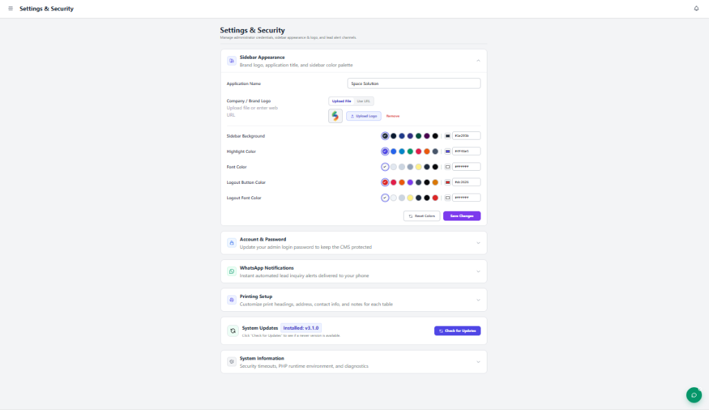
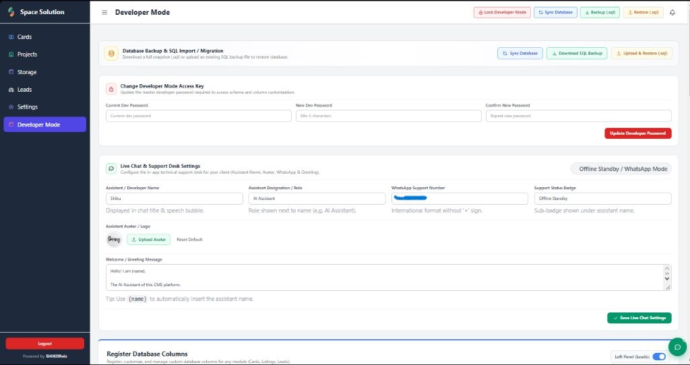
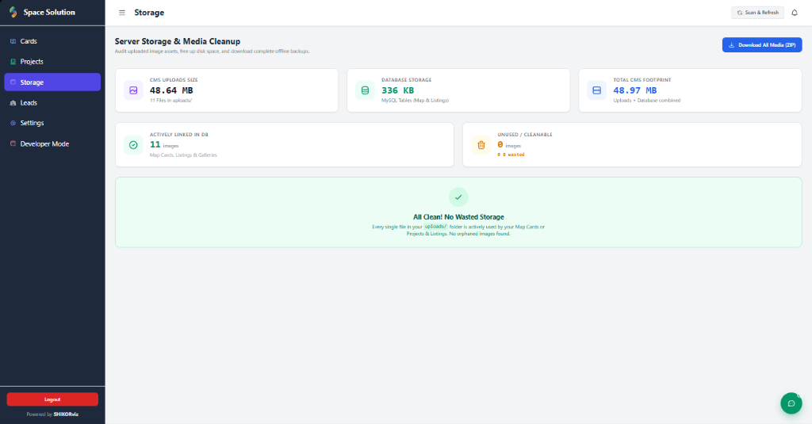
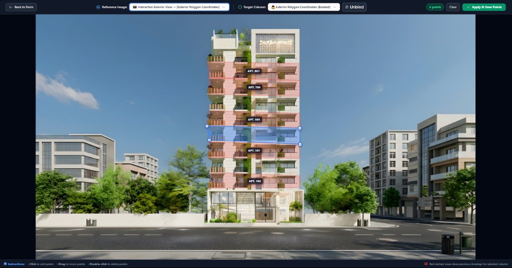

# Shikor Studio CMS (v3.0.0)

> A powerful, industry-agnostic **Universal Dynamic CMS, Interactive Visual Hotspot Mapper & White-Label Management Platform**. Built for any business, product catalog, visual portfolio, or enterprise workflow.

[](https://github.com/SHIKORVIZ/shikor_cms/releases)
[](https://php.net)
[](https://mysql.com)
[](#features)
[](#license)

---

## 🌟 Why Shikor Studio CMS?

Unlike traditional CMS platforms locked into a single rigid schema, **Shikor Studio CMS** is a completely dynamic, schema-flexible application. It can be tailored to **any industry**—from interactive product showcases, venue & event floorplans, automotive catalogs, healthcare directories, to visual real-estate and architectural presentations.

Administrators and developers can dynamically register columns, create interactive visual hotspots on any reference imagery, capture leads with instant WhatsApp notifications, and customize the entire software appearance to their brand identity.

---

## 🚀 Key Features

### 🛠️ 1. Dynamic Column Registration & Schema Builder (Developer Mode)
- **Zero-SQL Field Creation**: Register, customize, and manage custom database columns for any module (Cards, Listings, Leads) on the fly.
- **Diverse Input Types**: Support for text, textarea, select dropdowns, numbers, currency, URLs, banners, image galleries, and interactive polygon coordinates.
- **Instant Database Sync**: 1-click automatic schema synchronization between user interface definitions and the MySQL database engine.

### 📐 2. Interactive Visual Hotspot & Polygon Mapper
- **Universal Coordinate Mapping**: Draw custom polygon coordinates over **any** reference image (blueprints, architectural elevations, machinery parts, event layouts, vehicle maps, etc.).
- **Live Data Binding**: Bind drawn polygon hotspots directly to any database record with status tracking (e.g., Booked, Available, Reserved).
- **Precise Vector Controls**: Drag control points, snap-to-edge, multi-polygon overlay, and real-time color highlights.

### 🎨 3. 100% White-Label & Full Branding Suite
- **Complete Visual Customization**: Upload brand logo or use remote URLs, set custom application titles, and customize browser favicon.
- **Granular Palette Controls**: Full color customization for sidebar background, highlights, typography, and logout buttons with instant live preview.

### 💬 4. In-App Support Desk & Virtual Assistant
- **Custom Client Assistant**: Configure an in-app support assistant with custom name, avatar, role/designation, and status badge.
- **WhatsApp Support Hotlink**: Direct click-to-chat integration with pre-configured international numbers and automated greeting templates.

### 📱 5. Lead Management & WhatsApp Notifications
- **Dynamic Inquiry Capture**: Built-in lead tracking system with custom status stages, notes, and contact tracking.
- **Instant WhatsApp Alerts**: Automatically route incoming lead inquiries directly to mobile devices via WhatsApp alert triggers.

### 🖨️ 6. Enterprise Print Engine
- **Customized Table Printing**: Configure print headers, company address, contact information, and terms for clean professional PDF/paper printouts.

### 💾 7. Storage Audit & 1-Click Media Cleanup
- **Disk Space Footprint Analyzer**: Real-time breakdown of upload file counts, directory sizes, and MySQL table storage.
- **Orphaned Media Cleanup**: Automatically detect unused images across all tables with 1-click cleanup to free disk space.
- **1-Click Media ZIP Export**: Download all uploaded media assets into a consolidated ZIP backup.

### 🔄 8. GitHub Releases 1-Click Auto-Updater
- **Zero-Downtime Remote Updates**: Seamlessly check for updates and install official releases directly from GitHub Releases without overwriting user data or configuration files (`db.php`, `uploads/`).

### 🛡️ 9. Enterprise-Grade Security
- Dual-tier auto-lock timeouts (3-minute developer lock, 5-minute session logout).
- Built-in CSRF token protection across all actions.
- Persistent IP-based brute-force login throttling.
- Bcrypt password hashing.

---

## 🔑 Default Universal Login Credentials

Upon fresh installation or download, use these universal credentials to access the system:

| Access Level | Username | Password |
| :--- | :--- | :--- |
| **CMS Administrator Login** | `shikorviz` | `shikorviz@2017` |
| **Developer Mode Access Key** | *(Prompted in Tab)* | `shikorviz@2017` |

> ⚠️ **Security Tip**: Immediately change these default passwords via **Settings & Security** and **Developer Mode** after your initial setup.

---

## 📸 Screenshots & Workflow

| Settings & White-Label Customization | Developer Mode & Support Desk |
| :---: | :---: |
|  |  |

| Storage Audit & Cleanup | Interactive Hotspot & Polygon Mapper |
| :---: | :---: |
|  |  |

---

## 💻 Installation & Setup

### Requirements
- **PHP**: `7.4` to `8.2+`
- **Extensions**: `pdo_mysql`, `mbstring`, `zlib`, `curl`, `json`
- **Database**: `MySQL 5.7+` or `MariaDB 10.2+`
- **Server**: Apache (with `mod_rewrite`) / Nginx / LiteSpeed

---

### Deploying on cPanel / Shared Hosting

1. **Download Release Package**:  
   Download `shikor_cms_v3.0.0_release.zip` from [GitHub Releases](https://github.com/SHIKORVIZ/shikor_cms/releases).

2. **Upload & Extract**:  
   In cPanel File Manager, upload the ZIP archive to your root directory or subdomain folder and click **Extract**.

3. **Configure Database**:  
   - Create a MySQL Database & User in cPanel.
   - Open **phpMyAdmin**, select the database, and **Import** `database.sql`.

4. **Connect `db.php`**:  
   Edit `db.php` with your cPanel database credentials:
   ```php
   $host   = 'localhost';
   $dbname = 'your_cpanel_db_name';
   $user   = 'your_cpanel_db_user';
   $pass   = 'your_database_password';
   ```

5. **Log In & Customize**:  
   Open the website in your browser, log in with `shikorviz` / `shikorviz@2017`, and configure your own branding, columns, and modules!

---

### Localhost Setup (XAMPP / Laragon / WampServer)

1. Extract files into `htdocs/shikor_cms` (or `www/shikor_cms`).
2. Create a database named `real_estate_db` (or any custom name) in phpMyAdmin.
3. Import `database.sql`.
4. Open `http://localhost/shikor_cms/` in your browser.

---

## 📦 Building Releases for Distribution

To generate an obfuscated, lightweight distribution package:
1. Double-click `build_release.bat`.
2. Enter version `3.0.0` and changelog notes.
3. The production-ready archive is created in `releases/shikor_cms_v3.0.0_release.zip`.

---

## 📄 License & Credits

Developed with ❤️ by **[SHIKOR Visualization Firm](https://shikorviz.com)**.  
All Rights Reserved.
